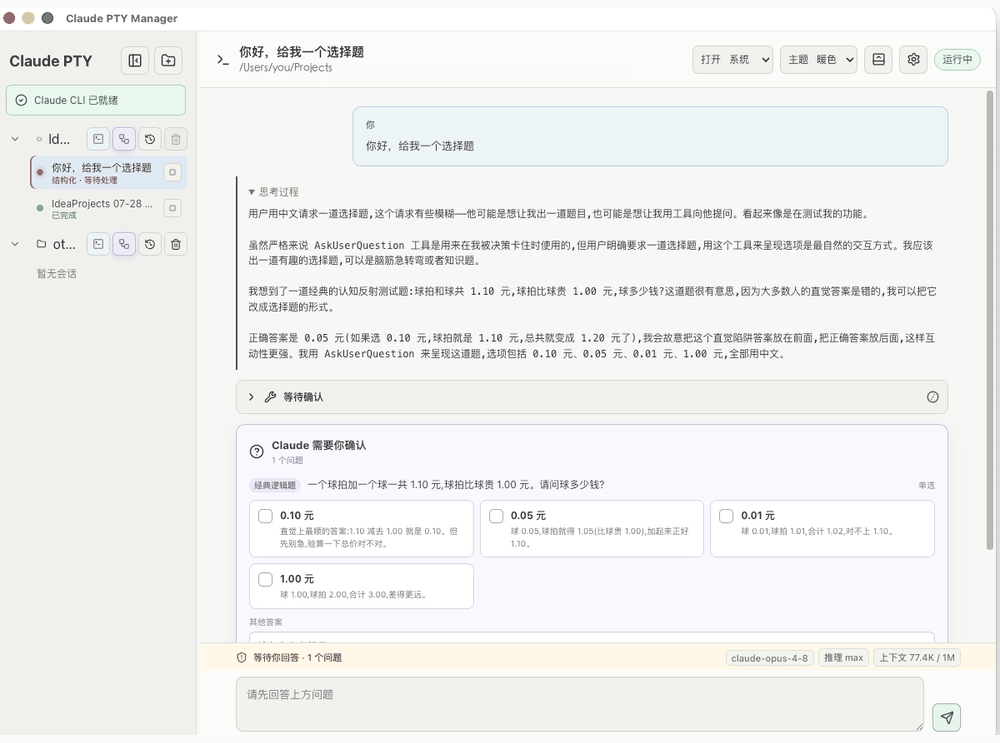
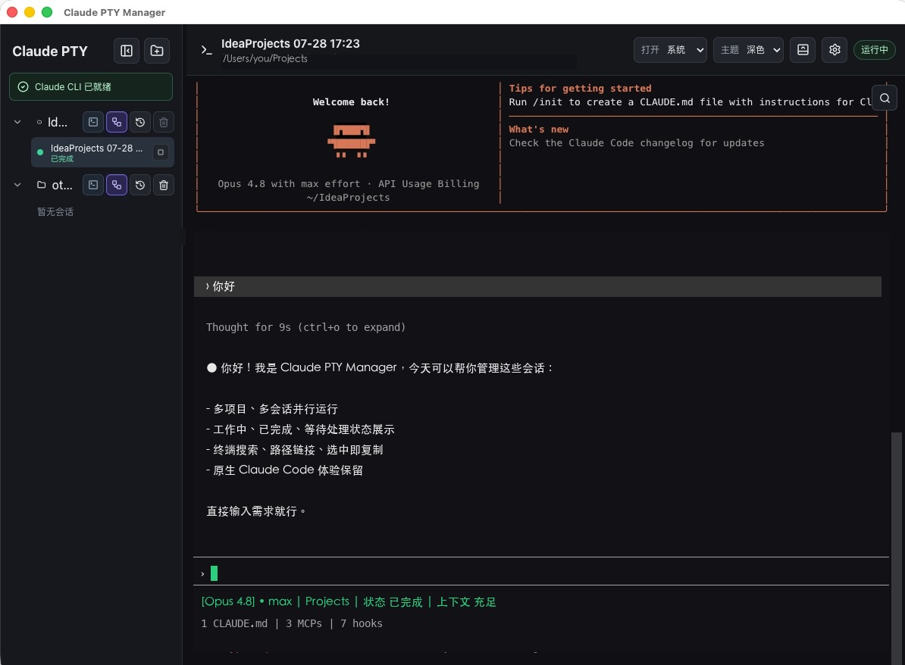
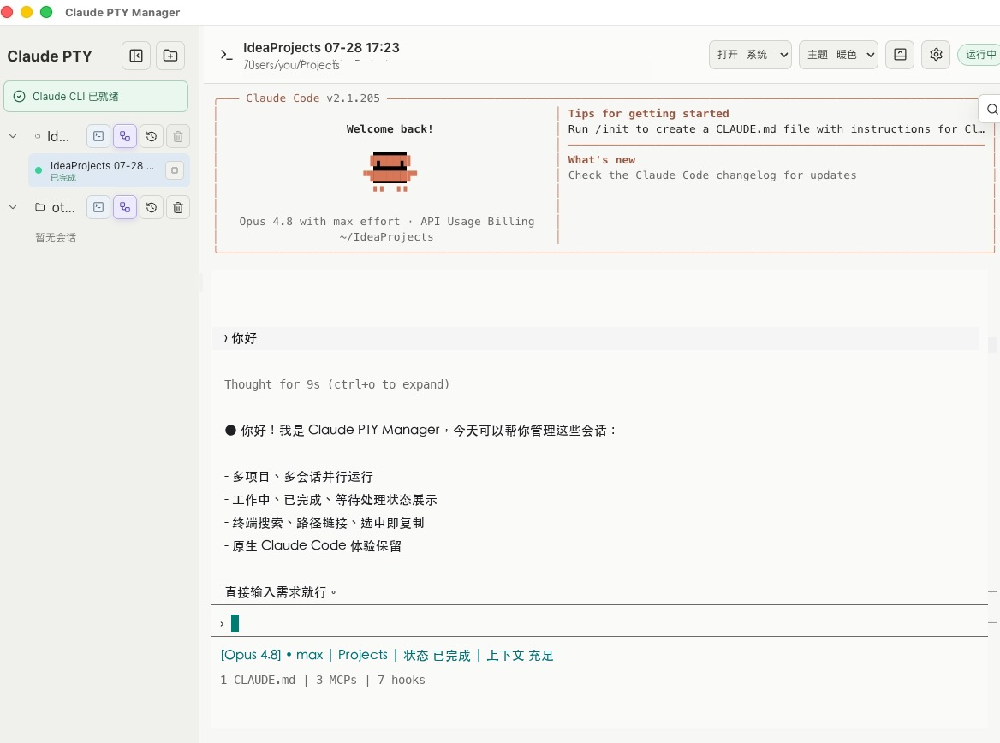
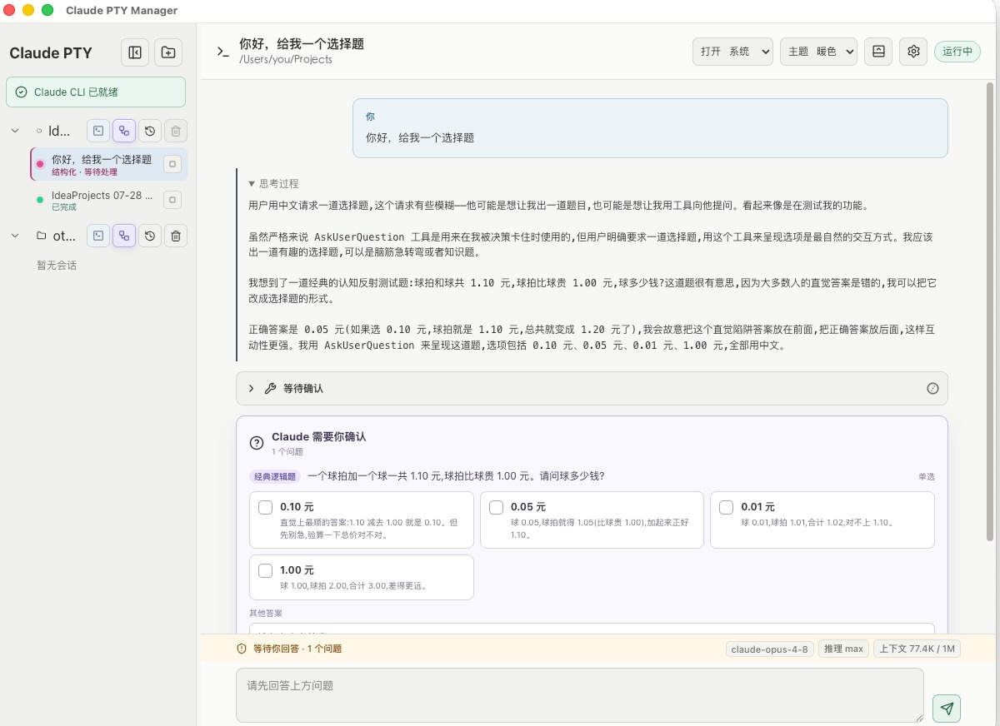

# Claude PTY Manager

A native macOS workbench for **Claude Code**: run many sessions in parallel, keep the real terminal, track working / blocked status at a glance, and switch any session to a Codex-style structured view. Local-first, no telemetry.

Claude PTY Manager 是一个面向 macOS 的 Claude Code 桌面会话管理器：原生 PTY 终端、多项目并行会话、状态悬浮窗，以及类 Codex 的结构化输出。

> 本项目是非官方第三方工具，与 Anthropic 不存在隶属、授权或背书关系。Claude、Claude Code 及相关名称归其各自权利人所有。

## 界面预览

<p align="center">
  <a href="docs/screenshots/preview.gif">
    
  </a>
</p>

<p align="center">
  <sub>原生终端深色主题、浅色主题和结构化会话模式预览。</sub>
</p>

| 深色主题 | 浅色主题 | 结构化会话 |
| --- | --- | --- |
| [](docs/screenshots/dark-theme.jpg) | [](docs/screenshots/light-theme.jpg) | [](docs/screenshots/structured-mode.jpg) |

## 核心功能

### 原生 PTY 代理

- 默认通过 `node-pty` 启动 Claude Code，尽量保留原生 TUI、权限确认、Slash 命令和工具输出体验。
- 每个 Claude 会话使用独立 PTY 进程，后台会话可以继续运行。
- 支持终端搜索、选中即复制、文件路径链接以及 IDEA/系统打开方式。

### 会话、终端与状态管理

- 按项目目录管理 Claude 会话。
- 支持新建、导入、恢复、重命名和移除会话记录。
- 支持多个项目和多个会话并行运行。
- 使用 Claude Session ID 恢复历史上下文。
- 通过 Claude Code Hook 获取工作中、已完成和等待处理状态。
- 提供可拖动的桌面悬浮状态窗口，便于关注后台会话。
- 提供可展开的项目 Shell 终端、浅色/深色主题和本地诊断日志。

### 结构化输出（尝鲜）

结构化模式使用 Claude Code `stream-json` 协议，将回复、思考过程、工具调用、权限确认和结构化提问分别展示。

该模式仍在试验阶段，不保证稳定，也不承诺兼容所有 Claude Code 版本、插件、MCP 工具或交互流程。需要稳定原生体验时，请使用默认的原生终端模式。

## 运行要求

- macOS。
- 已安装并完成登录的 [Claude Code](https://docs.anthropic.com/en/docs/claude-code)。
- 发布产物目前以 Apple Silicon（arm64）为主；Intel Mac 可以从源码自行构建。
- IntelliJ IDEA 为可选依赖；文件链接也可以配置为使用系统默认应用打开。

## 普通用户安装（推荐）

普通用户不需要安装 Node.js 或 npm，也不需要执行 `npm run dev`：

1. 从 [GitHub Releases](https://github.com/Hendiaome/Claude-PTY/releases) 下载 arm64 DMG。
2. 打开 DMG，把 `Claude PTY Manager` 拖入“应用程序”。
3. 从“应用程序”中启动，添加项目目录后即可创建会话。

当前发布包没有 Apple Developer ID 签名。如果 macOS 提示无法验证开发者，请先确认 DMG 来自本项目官方 GitHub Release，再到“系统设置 → 隐私与安全性”中选择仍要打开。

如果仍然无法启动，可以执行以下命令移除该应用的下载隔离标记：

```bash
sudo xattr -rd com.apple.quarantine "/Applications/Claude PTY Manager.app"
```

该命令会降低 macOS 对目标应用的首次运行检查，只应对来源可信且路径确认无误的安装包执行。

## 开发者运行

源码开发需要 Node.js 22.12 或更高版本及 npm：

```bash
git clone https://github.com/Hendiaome/Claude-PTY.git
cd Claude-PTY
npm ci
npm run dev
```

生产构建：

```bash
npm run build
```

## macOS 打包

生成本地 `.app`：

```bash
npm run pack:mac
```

生成 DMG 和 ZIP：

```bash
npm run dist:mac
```

产物写入项目根目录下的 `release/`，文件名类似：

```text
Claude-PTY-Manager-1.1.1-arm64.dmg
Claude-PTY-Manager-1.1.1-arm64.zip
```

`release/` 不会提交到 Git。

打包脚本默认使用 Electron 官方下载源。在访问官方源较慢的网络环境中，可以按需指定镜像：

```bash
ELECTRON_MIRROR=https://npmmirror.com/mirrors/electron/ \
ELECTRON_BUILDER_BINARIES_MIRROR=https://npmmirror.com/mirrors/electron-builder-binaries/ \
npm run dist:mac
```

## 发布与更新文件

应用默认每四小时读取仓库根目录的 [`latest.json`](latest.json)，不调用 GitHub Releases API。`raw.githubusercontent.com` 不需要单独上传文件；只要把项目根目录的 `latest.json` 提交并推送到 GitHub 的 `main` 分支，GitHub 会自动提供对应的 Raw 访问地址。

发布新版本时：

1. 修改 `package.json` 和 `package-lock.json` 中的版本号。
2. 执行 `npm run dist:mac` 生成 DMG 和 ZIP。
3. 创建形如 `v1.1.1` 的 GitHub Release，并上传生成的安装包。
4. 更新 `latest.json` 中的版本号、DMG 下载地址和更新说明。
5. 提交并推送 `latest.json`，更新检查会从项目内这个文件读取最新版本。

更新地址默认为：

```text
https://raw.githubusercontent.com/Hendiaome/Claude-PTY/main/latest.json
```

用户也可以在设置中关闭自动检查或替换为其他兼容的 JSON 地址。

## 本地数据与隐私

应用自身不包含遥测、代码上传或会话正文上报功能。Claude Code 的网络请求、账号、模型调用和数据处理行为由 Claude Code 及 Anthropic 的配置和条款决定，不属于本应用的数据链路。

应用会在本地保存：

- 项目与会话映射、界面设置：`~/Library/Application Support/Claude PTY Manager/`
- 诊断日志：`~/Library/Logs/Claude PTY Manager/claude-pty.log`
- Claude 会话正文仍由 Claude Code 保存到其自己的 `~/.claude/projects/` 目录。

诊断日志不会主动记录原始终端输入、终端输出或 Claude 会话正文，但会包含故障排查所需的本地文件路径、项目路径、进程状态、退出码和运行环境元数据。分享日志或截图前，请自行检查并脱敏。

启用自动更新检查后，应用每四小时读取一次仓库中的 `latest.json`。

## 安全边界

- 本应用启动的 Claude Code 和项目 Shell 继承当前 macOS 用户权限，能够访问本机文件并执行命令。
- 只应添加可信项目，并在执行 Claude Code 提出的工具权限请求前检查具体操作。
- 会话状态 Hook 通过随机令牌保护的本机回环地址通信，只上报会话状态元数据，不上报 Prompt 或工具参数。
- 应用不会修改 Claude transcript 正文；导入和标题提取只读访问 Claude 历史文件。
- 发现安全问题时，请按 [SECURITY.md](SECURITY.md) 中的方式私下报告。

## 已知限制

- 当前只支持 macOS。
- 发布包尚未进行 Apple Developer ID 签名和公证。
- 结构化模式属于尝鲜功能，Claude Code 升级可能导致兼容性变化。
- 会话能否恢复取决于对应 Claude JSONL 历史是否已经生成且仍然存在。
- 应用管理的是本机 Claude Code 进程，不提供跨设备同步。

## 参与贡献

欢迎提交 Issue 和 Pull Request。开发约定与提交流程见 [CONTRIBUTING.md](CONTRIBUTING.md)。

## License

本项目使用 [MIT License](LICENSE)。
